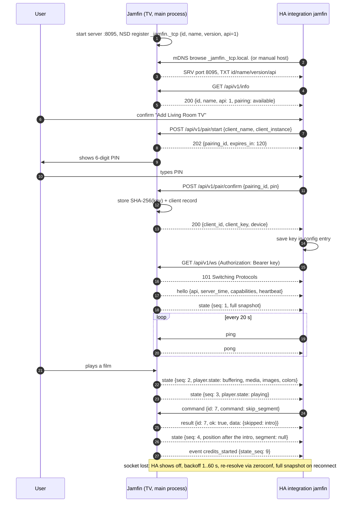

# Jamfin local API, v1 (spec draft)

The contract between **Jamfin TV** (the server, running on the TV) and the Home Assistant custom integration
**`jamfin`** (the client, repo `jamfin-ha`). Status: **draft, 2026-11-12**, with the JamFin Agent's review
answers folded in the same day (Q2 privacy, Q3 TLS, Q4 background commands, Q5 foreground service, Q11 colours are
closed, see section 17).

Agreed between the JamFin Agent and the Home Assistant session; additions from Isaac (images, colours) included.
Where this draft decides something the brief left open, it says so under **Decision** with the reason.

Contents:
1. Overview and goals
2. Discovery (mDNS/NSD)
3. Transport, conventions, errors
4. Pairing and authentication
5. REST endpoints
6. WebSocket
7. State model
8. Events
9. Commands
10. Reconnect and lifecycle rules
11. Disc playback (`:disc` process)
12. Security
13. Coexistence with the core Jellyfin integration
14. Migration from the beta 4 outbound link
15. Versioning
16. Sequence diagram
17. Open questions

Key words MUST, SHOULD, MAY are used in the RFC 2119 sense.

---

## 1. Overview and goals

- **Local push.** Jamfin pushes state and events to Home Assistant over one WebSocket per paired client. No
  polling, no cloud, no Jellyfin server API key on the Home Assistant side.
- **Jamfin is the server**, the integration is the client. The TV never connects out to Home Assistant for this API
  (the beta 4 outbound link stays as a fallback during the beta, see section 14).
- **One paired client = one key.** Up to 5 paired clients per TV (usually one Home Assistant; a second for a dev
  instance or a test harness).
- **Scope of v1:** state, events, the beta 5 commands, art proxy. Disc state relay is "5b" (section 11).

Terms: *server* = the Jamfin app's local API on the TV (main process). *client* = a paired consumer (the HA
integration). *Active profile* = the Jellyfin user signed in and picked in Jamfin right now.

Source names in Jamfin that this spec maps onto (branch `mobile`, 2026-11-12):
`remote/RemoteDispatcher` + `RemoteCommand` (the Jellyfin "Play on" remote; commands here reuse its rules),
`playback/Segments.kt` (`SegmentKind` Intro/Recap/Preview/Commercial/Outro), `data/catalog/Chapter`,
`playback/LangStream`, `playback/PlaybackSpeed.OPTIONS`, `playback/Completion.kt` (B7), `playback/AutoAdvance.kt`
(A11), `data/catalog/PreShow.kt`, `beta/movienight/VoteServer.kt`, `beta/RoomLink.kt`, `beta/ha/*` (beta 4 link),
`ui/disc/DiscPlayerActivity` (`android:process=":disc"`).

---

## 2. Discovery (mDNS / DNS-SD via Android NSD)

Jamfin registers one service with `NsdManager` while its server runs:

| Field | Value |
|---|---|
| Service type | `_jamfin._tcp.local.` |
| Instance name | The TV's device name (`Settings.Global.DEVICE_NAME`, e.g. `Living Room TV`). NSD may append ` (2)` on conflicts; clients MUST NOT use it as an id. |
| SRV port | The port the server actually bound (default **8095**, see below). |
| TXT `id` | Stable device UUID (lower-case, dashed). Generated once with `UUID.randomUUID()` on first server start, stored app-private (DataStore, not backed up). Not the Android ID, not the Jellyfin DeviceId. |
| TXT `name` | Same as the instance name before conflict renaming (UTF-8, max 63 bytes, truncated). |
| TXT `version` | Jamfin `versionName`, e.g. `0.5.0-beta5`. |
| TXT `api` | `1`. Highest API major the server speaks (section 15). |

Example (as `avahi-browse -r` would show it):

```
= eth0 IPv4 Living Room TV  _jamfin._tcp  local
   hostname = [Android-3.local]
   address = [192.168.20.63]
   port = [8095]
   txt = ["api=1" "version=0.5.0-beta5" "name=Living Room TV" "id=6f1d0c52-6b3e-4f6e-9a54-2d1f0a7c9e11"]
```

**Port.** The server binds TCP **8095** on all interfaces. If 8095 is taken it tries the port it used last time
(stored), then an ephemeral port (bind 0). The SRV record always carries the real port.
*Decision:* "last used port" before ephemeral, so a manually configured client keeps working across restarts when
8095 stays taken.

**Clients:** the unique id of a TV is TXT `id`. Host and port are only a current address: when a known `id` shows up
on another host/port, the client updates its stored address (HA: `_abort_if_unique_id_configured(updates=...)`).

**Discovery does not cross subnets.** mDNS is link-local multicast. In a split home network HA (192.168.1.10) and the TV
(192.168.20.63) are on different routed subnets, so zeroconf discovery only works with an mDNS reflector on the
router. Manual host entry (section 5.1 `GET /api/v1/info`) is therefore a first-class path, not a fallback.

---

## 3. Transport, conventions, errors

- Plain HTTP/1.1 and WebSocket (RFC 6455) on the LAN, no TLS in v1 (decided, section 12; Q3 closed).
- All bodies are UTF-8 JSON (`Content-Type: application/json`), except art (images).
- Field names `snake_case`. Unknown fields MUST be ignored by both sides.
- **Times** (positions, durations, chapter starts) are **seconds** as JSON numbers with up to 3 decimals
  (`1234.567`). *Decision:* seconds because HA's media_player works in seconds; Jamfin converts from its ms.
- **Timestamps** are ISO 8601 UTC with milliseconds and `Z`: `2026-11-12T20:15:03.120Z`, from the TV's clock
  (NTP-synced on Android TV). Every server message on the socket carries `server_time` in `hello` so a client can
  measure skew (section 7.6).
- **Jellyfin ids** are sent as the server's 32-character lower-case hex "N" form (no dashes), as the Jellyfin API
  returns them. Clients MAY send either the N form or a dashed UUID; Jamfin normalises (`RemoteIds.normalize`).
- **Enum values** are lower-case strings. Clients MUST treat an unknown enum value as "unknown" (not an error).
- Strings that come from the library (titles, names) are truncated to 200 characters.

### 3.1 Error object

Every REST error and every failed command result uses the same object:

```json
{
  "error": {
    "code": "invalid_pin",
    "message": "Wrong PIN. 2 tries left.",
    "attempts_left": 2,
    "retry_after": null
  }
}
```

`code` is machine-readable (stable, listed below); `message` is English, for logs and the HA UI, never parsed.
Extra fields depend on the code (`attempts_left`, `retry_after` in seconds).

| code | HTTP | Meaning |
|---|---|---|
| `invalid_request` | 400 | Malformed JSON, missing or wrong-typed field. |
| `unauthorized` | 401 | Missing, malformed, unknown or revoked client key. |
| `invalid_pin` | 401 | Wrong PIN; `attempts_left` says how many remain for this pairing. |
| `not_found` | 404 | Unknown path, pairing id, Jellyfin item, or art not available. |
| `method_not_allowed` | 405 | |
| `pairing_in_progress` | 409 | Another pairing is showing its PIN; `retry_after` = seconds until it expires. |
| `too_many_clients` | 409 | 5 clients are paired; revoke one in Jamfin Settings > Home Assistant. |
| `not_in_foreground` | 409 | Needs Jamfin on screen (pairing PIN, opening the player from the background). |
| `pairing_expired` | 410 | The PIN timed out or was cancelled (3 wrong tries, Back on the TV). |
| `payload_too_large` | 413 | Body or WebSocket message over the limit (section 12). |
| `rate_limited` | 429 | Too many attempts; `retry_after` seconds (also in the `Retry-After` header). |
| `internal` | 500 | Bug; details only in Jamfin's logcat. |
| `not_ready` | 503 | The server is starting or shutting down. |

Command-only codes (results on the socket, HTTP 409/422 on `POST /api/v1/command`): see section 9.2.

---

## 4. Pairing and authentication

### 4.1 Flow

1. The client calls `POST /api/v1/pair/start`. Jamfin must be **in the foreground** (it has to show the PIN; an
   app in the background can't put a screen up on Android 10+). The TV shows a 6-digit PIN and the client's name.
2. The user reads the PIN on the TV and types it into Home Assistant.
3. The client calls `POST /api/v1/pair/confirm` with the PIN. On success the server returns a **client key** once.
4. The client stores the key (HA config entry data) and presents it as `Authorization: Bearer <key>` on every
   REST request and on the WebSocket upgrade.

How and where the PIN is shown on the TV (over playback, over menus) is a Jamfin design decision, not part of this
contract (open question Q6).

### 4.2 PIN and key rules

- PIN: 6 decimal digits, uniform from `SecureRandom` (`000000`..`999999`), valid **120 s**, **3 tries**. The third
  wrong try cancels the pairing (the TV hides the PIN; `confirm` then answers `pairing_expired`).
- Only **one pairing at a time** TV-wide. A second `start` while a PIN shows answers `pairing_in_progress` with
  `retry_after`. *Decision:* reject instead of replace, so a second requester can't knock the real user's PIN off
  the screen.
- **Lockout:** 3 cancelled-by-wrong-PIN pairings within 15 min lock pairing for 15 min TV-wide (`rate_limited`,
  `retry_after`), and the TV says so in Settings > Home Assistant. Plus per source IP: max 5 `start` per 10 min.
  With 3 tries per PIN and 3 failed pairings per 15 min, a guesser gets at most 9 guesses per 15 min against a
  1-in-10^6 PIN.
- **Client key:** 32 bytes from `SecureRandom`, encoded **base64url without padding** (43 characters).
  Returned exactly once, in the `confirm` response.
- **Storage on the TV:** only `SHA-256(key)` (hex) plus the client record `{client_id, name, instance, created_at,
  last_seen_at}`, in an app-private DataStore that is not backed up. The key itself is never stored, logged or
  shown. Lookup by hash, compared in constant time. *Decision:* a plain SHA-256 is enough because the key has
  256 bits of entropy (a slow KDF only helps against low-entropy secrets).
- **Max 5 paired clients.** `start` answers `too_many_clients` when 5 are paired, **except** when the request's
  `client_instance` matches an existing client: then a successful `confirm` **replaces** that client's key (same
  `client_id`). *Decision:* re-pairing the same HA (reauth, reinstall of the integration) must not use up slots.
- **Revocation:** Jamfin Settings > Home Assistant lists paired clients (name, paired at, last seen) with Revoke.
  Revoking deletes the record, closes its open WebSocket with close code **4401**, and every later request gets 401.
  A client can unpair itself with `DELETE /api/v1/pair`.

### 4.3 Presenting the key

**Decision: `Authorization: Bearer <key>` header everywhere, including the WebSocket upgrade request.** No `auth`
first message.

Why:
- The server rejects a bad key with a plain HTTP 401 **before** upgrading, so no unauthenticated socket ever
  exists: no auth timeout state, no half-open sockets to rate-limit, and the same check code for REST and WS.
- The only client is Home Assistant (aiohttp `ws_connect(headers=...)` supports it). Browsers can't set headers on
  WebSockets, but browsers are not a client of this API.
- Keys never go in URLs or query strings (they would end up in logs and proxies). A key in a URL is rejected
  (`invalid_request`) and not checked, so it isn't usable even by accident.

A revoked or unknown key on an open socket ends it with close code 4401. The client then MUST NOT retry with the same
key in a loop: HA starts a reauth flow (section 10).

---

## 5. REST endpoints

Base path `/api/v1`. "Auth" = `Authorization: Bearer <key>` required.

| Method | Path | Auth | Purpose |
|---|---|---|---|
| GET | `/api/v1/info` | no | Identity for manual setup and probing |
| POST | `/api/v1/pair/start` | no | Ask the TV to show a PIN |
| POST | `/api/v1/pair/confirm` | no | Submit the PIN, receive the key |
| POST | `/api/v1/pair/cancel` | no | Abort a pairing (HA flow closed) |
| DELETE | `/api/v1/pair` | yes | Unpair this client (self-revoke) |
| GET | `/api/v1/state` | yes | Current state snapshot (diagnostics, one-off reads) |
| POST | `/api/v1/command` | yes | Same commands as the socket (testing, curl) |
| GET | `/api/v1/art/<kind>/<id>` | yes | Image proxy (section 7.4) |
| GET | `/api/v1/ws` | yes | WebSocket upgrade (section 6) |

### 5.1 `GET /api/v1/info`

Public identity only: no profile, no media, nothing about what plays.

```json
{
  "id": "6f1d0c52-6b3e-4f6e-9a54-2d1f0a7c9e11",
  "name": "Living Room TV",
  "model": "SmartTV 4K FFM",
  "app_version": "0.5.0-beta5",
  "api": 1,
  "api_versions": [1],
  "pairing": "available"
}
```

`pairing`: `available` | `in_progress` | `locked` | `full` (5 clients) | `needs_foreground`.

### 5.2 `POST /api/v1/pair/start`

Request:

```json
{
  "client_name": "Home Assistant (Home)",
  "client_instance": "8b1f2c4e9d0a4f1e8c7b6a5d4e3f2a1b"
}
```

`client_name` (required, 1..64 chars) is shown on the TV next to the PIN and in the client list.
`client_instance` (required, 1..64 chars `[A-Za-z0-9_-]`) is a stable id of the client installation (HA:
`homeassistant.helpers.instance_id`); it lets a re-pair replace the old key.

Response `202 Accepted`:

```json
{ "pairing_id": "p_5k2m9q7x", "expires_in": 120, "pin_length": 6, "attempts": 3 }
```

Errors: `pairing_in_progress` 409, `too_many_clients` 409, `not_in_foreground` 409, `rate_limited` 429,
`invalid_request` 400.

### 5.3 `POST /api/v1/pair/confirm`

```json
{ "pairing_id": "p_5k2m9q7x", "pin": "042917" }
```

Response `200 OK`:

```json
{
  "client_id": "c_7hq2w9",
  "client_key": "q9V7k0Jm1hS3b0x2c8yZ4tP6eR5uW1aN7dF3gH9jK2l",
  "device": {
    "id": "6f1d0c52-6b3e-4f6e-9a54-2d1f0a7c9e11",
    "name": "Living Room TV",
    "model": "SmartTV 4K FFM",
    "app_version": "0.5.0-beta5"
  },
  "api": 1
}
```

Errors: `invalid_pin` 401 (with `attempts_left`), `pairing_expired` 410, `not_found` 404 (unknown `pairing_id`),
`rate_limited` 429. The TV hides the PIN on success, on expiry, on the third wrong try and on `cancel`.

### 5.4 `POST /api/v1/pair/cancel`

```json
{ "pairing_id": "p_5k2m9q7x" }
```

`204 No Content` (also when it already ended). Lets HA hide the PIN when the user closes the config flow.

### 5.5 `DELETE /api/v1/pair`

Auth. Deletes the calling client's record. `204 No Content`; its open socket closes with **4401**. HA calls it
(best effort) from `async_remove_entry`.

### 5.6 `GET /api/v1/state`

Auth. `200` with the same object a WebSocket `state` message carries in `state` (section 7), plus `seq: null`.

### 5.7 `POST /api/v1/command`

Auth. Body = a command message without `type` (section 9):

```json
{ "id": "rest-1", "command": "seek", "args": { "position": 1834.0 } }
```

`200` with the result object (`{"id":"rest-1","ok":true,"data":{...}}`); a failed command answers **422** with the
same `ok:false` result body. *Decision:* the REST mirror exists for curl/tests and HA services while the socket
reconnects; the socket stays the primary path.

---

## 6. WebSocket

`GET /api/v1/ws` with `Authorization: Bearer <key>` and the usual upgrade headers. Subprotocol: none. Each
message is one JSON text frame with a `type`. Binary frames are refused (close 1003).

### 6.1 Server → client

| type | When |
|---|---|
| `hello` | First message after the upgrade. |
| `state` | Right after `hello` (full snapshot, `seq` 1), then on every change (section 6.4). |
| `event` | A moment happened (section 8). |
| `result` | Answer to a client `command`, matched by `id`. |
| `pong` | Answer to a client `ping`. |

`hello`:

```json
{
  "type": "hello",
  "api": 1,
  "server_time": "2026-11-12T20:15:00.004Z",
  "client_id": "c_7hq2w9",
  "device": {
    "id": "6f1d0c52-6b3e-4f6e-9a54-2d1f0a7c9e11",
    "name": "Living Room TV",
    "model": "SmartTV 4K FFM",
    "app_version": "0.5.0-beta5"
  },
  "capabilities": {
    "commands": ["play", "pause", "toggle", "stop", "seek", "next_chapter", "previous_chapter",
                 "skip_segment", "set_audio_track", "set_subtitle_track", "play_media", "go_home"],
    "events": ["preshow", "movienight", "movienight_winner", "credits_started", "item_finished",
               "next_up", "chapter_changed", "segment_started"],
    "features": ["images", "colors"]
  },
  "heartbeat": { "ping_interval": 20, "pong_timeout": 10, "idle_timeout": 60 },
  "limits": { "max_message_bytes": 16384, "commands_per_second": 10 }
}
```

`capabilities.features` lists optional parts the client may build entities for: `images`, `colors`,
`disc_relay` (from beta 5b, section 11). A client MUST NOT assume a feature that isn't listed.

### 6.2 Client → server

| type | Fields |
|---|---|
| `command` | `id`, `command`, `args` (section 9) |
| `ping` | `id` (optional) |

```json
{ "type": "ping", "id": 41 }
```
```json
{ "type": "pong", "id": 41, "server_time": "2026-11-12T20:15:20.010Z" }
```

Anything else gets an `error` result if it has an `id`, else is ignored and logged once.

### 6.3 Heartbeat and timeouts

- The client sends `ping` every **20 s** (`heartbeat.ping_interval`). The server answers `pong` at once.
- No `pong` within **10 s** (`pong_timeout`): the client closes the socket and reconnects (section 10).
- The server closes a socket with code **4002** when it received nothing (no ping, no command) for **60 s**
  (`idle_timeout`).
- WebSocket protocol-level ping/pong frames are answered too (aiohttp `heartbeat=` works), but the JSON ping is
  the contract because it also proves the app's message loop is alive, not just the socket thread.
- Worst-case detection of a TV that vanished (power cut, Wi-Fi gone): 20 + 10 = 30 s on the client.

### 6.4 State pushes

**Decision: every `state` message carries the full state object, never a patch.** The object is small (a few KB;
the largest parts are chapters and tracks, which are capped, section 12), changes a few times a minute at most,
and full objects make reconnects, missed messages and client bugs impossible to drift from. If measurements ever
show a problem, patches can be added as a v1 feature (`features: ["patches"]`).

```json
{ "type": "state", "seq": 17, "state": { "...": "section 7" } }
```

- `seq` is per connection, starts at **1** with the snapshot after `hello`, and increases by exactly 1 per `state`
  message. Events and results carry `state_seq` = the `seq` of the last `state` sent before them.
- A state is pushed whenever any field changes, **except** the playback position, which is extrapolated by the
  client from `position`, `position_updated_at` and `playback_rate` (HA's media_player model). The server pushes a
  new position only on a discontinuity: play/pause/buffering change, seek, rate change, item change, or when the
  real position drifts more than **2 s** from the extrapolation (stall, chapter jump).
- Pushes are coalesced to at most **4 per second** (the newest state wins); events and results are never coalesced
  and never dropped.
- Message order on one socket is the order things happened. A command's `result` is sent when the command was
  handed to the player (accepted), the `state` reflecting it follows when the player reports it (usually < 1 s).

### 6.5 Close codes

| Code | Meaning | Client action |
|---|---|---|
| 1000 | Normal close | none |
| 1001 | Jamfin is shutting the server down (process ending, server disabled) | reconnect with backoff |
| 1003 | Binary frame | fix the client |
| 1009 | Message too big | fix the client |
| 4000 | Replaced: the same client opened a newer socket | don't reconnect this one |
| 4002 | Idle timeout (no ping) | reconnect |
| 4401 | Key revoked or unknown (also after the client unpairs itself, §5.5) | stop, start reauth (not after its own unpair) |
| 4429 | Too many sockets / rate limit | reconnect after backoff |

One socket per client key: a new socket with the same key closes the older one with 4000.

---

## 7. State model

### 7.1 Full example (an episode playing)

```json
{
  "server_time": "2026-11-12T20:15:03.120Z",
  "device": {
    "id": "6f1d0c52-6b3e-4f6e-9a54-2d1f0a7c9e11",
    "name": "Living Room TV",
    "model": "SmartTV 4K FFM",
    "app_version": "0.5.0-beta5"
  },
  "app": { "state": "foreground", "screen": "player" },
  "profile": { "id": "a1b2c3d4e5f60718293a4b5c6d7e8f90", "name": "Alex" },
  "player": {
    "state": "playing",
    "source": "jellyfin",
    "playback_rate": 1.0,
    "in_disc_menu": null
  },
  "media": {
    "kind": "episode",
    "title": "Machine Learning",
    "series": "Silo",
    "season": 1,
    "episode": 2,
    "year": 2023,
    "duration": 3184.512,
    "position": 1834.0,
    "position_updated_at": "2026-11-12T20:15:03.118Z",
    "jellyfin_item_id": "4f1c2d3e4a5b6c7d8e9f0a1b2c3d4e5f",
    "jellyfin_series_id": "9e8d7c6b5a4f3e2d1c0b9a8f7e6d5c4b",
    "jellyfin_server_id": "0b5c6d7e8f9a0b1c2d3e4f5a6b7c8d9e",
    "is_disc": false,
    "preshow": null,
    "images": {
      "poster": {
        "url": "http://192.168.20.157:8096/Items/9e8d7c6b5a4f3e2d1c0b9a8f7e6d5c4b/Images/Primary?tag=3f2a9c&maxHeight=720",
        "proxy": "/api/v1/art/poster/9e8d7c6b5a4f3e2d1c0b9a8f7e6d5c4b"
      },
      "backdrop": {
        "url": "http://192.168.20.157:8096/Items/9e8d7c6b5a4f3e2d1c0b9a8f7e6d5c4b/Images/Backdrop/0?tag=77ab01&maxHeight=1080",
        "proxy": "/api/v1/art/backdrop/9e8d7c6b5a4f3e2d1c0b9a8f7e6d5c4b"
      },
      "thumb": {
        "url": "http://192.168.20.157:8096/Items/4f1c2d3e4a5b6c7d8e9f0a1b2c3d4e5f/Images/Primary?tag=c0ffee&maxHeight=540",
        "proxy": "/api/v1/art/thumb/4f1c2d3e4a5b6c7d8e9f0a1b2c3d4e5f"
      },
      "logo": {
        "url": "http://192.168.20.157:8096/Items/9e8d7c6b5a4f3e2d1c0b9a8f7e6d5c4b/Images/Logo?tag=51de0a&maxHeight=360",
        "proxy": "/api/v1/art/logo/9e8d7c6b5a4f3e2d1c0b9a8f7e6d5c4b"
      },
      "chapter": {
        "url": "http://192.168.20.157:8096/Items/4f1c2d3e4a5b6c7d8e9f0a1b2c3d4e5f/Images/Chapter/6?tag=aa31f0&maxHeight=360",
        "proxy": "/api/v1/art/chapter/4f1c2d3e4a5b6c7d8e9f0a1b2c3d4e5f?index=6"
      }
    },
    "colors": {
      "dominant": "#1d2a2f",
      "accent": "#c8a24a",
      "palette": ["#1d2a2f", "#c8a24a", "#6e7f7a"],
      "source": "poster"
    }
  },
  "tracks": {
    "audio": [
      { "index": 1, "language": "eng", "title": "English - Dolby Digital+ - 5.1 - Default", "codec": "eac3", "channels": 6, "default": true, "forced": false, "commentary": false },
      { "index": 2, "language": "ger", "title": "Deutsch - Dolby Digital+ - 5.1", "codec": "eac3", "channels": 6, "default": false, "forced": false, "commentary": false }
    ],
    "subtitle": [
      { "index": 3, "language": "eng", "title": "English - SUBRIP", "codec": "subrip", "default": false, "forced": false, "hearing_impaired": false, "image": false },
      { "index": 4, "language": "eng", "title": "English (Forced) - SUBRIP", "codec": "subrip", "default": false, "forced": true, "hearing_impaired": false, "image": false }
    ],
    "audio_selected": 1,
    "subtitle_selected": null
  },
  "chapters": {
    "list": [
      { "start": 0.0, "name": "Opening" },
      { "start": 312.4, "name": "Chapter 2" },
      { "start": 1790.0, "name": "The Door" }
    ],
    "current": 2
  },
  "segment": null
}
```

### 7.2 Fields

**`device`** (always): `id` (TXT id), `name`, `model` (`Build.MODEL`), `app_version`.

**`app`** (always):
- `state`: `foreground` (a Jamfin activity is started, including the `:disc` player) | `background` (the process
  lives, no Jamfin activity on screen).
- `screen` (informational, MAY be extended): `picker` | `home` | `detail` | `player` | `preshow` | `movienight` |
  `disc` | `settings` | `other` | `null` (background).

**`profile`**: `{id, name}` = the active Jellyfin user's id and display name; `null` while the profile picker or
sign-in shows, or before a profile is picked; the **string `"private"`** when the active profile has "Tell Home
Assistant what's playing" off (section 7.7). Clients MUST accept all three forms.

**`player`** (always):
- `state`: `idle` | `playing` | `paused` | `buffering` | `stopped` | `unknown`.
  - `idle`: nothing has played since the server or the profile started.
  - `playing` / `paused` / `buffering`: a Jamfin player (Jellyfin player, pre-show, or disc after 5b) is open.
  - `stopped`: something played and its player has closed; `media` still describes the last item until the next play.
  - `unknown`: only during disc playback before beta 5b (section 11).
  - Closing a player and opening the next within **3 s** (auto-advance to the next episode, pre-show to film) does
    **not** pass through `stopped`; the state goes `buffering` with the new `media` (same grace as `RoomLink`).
  - `off` is never sent: it is what HA shows when the TV is unreachable.
- `source`: `jellyfin` | `preshow` | `disc` | `null`.
- `playback_rate`: one of `PlaybackSpeed.OPTIONS` (0.5, 0.75, 1, 1.25, 1.5, 2); 1 when nothing plays.
- `in_disc_menu`: `true` / `false` while a disc plays (beta 5b), else `null`. **Absent before 5b.**

**`media`**: `null` when `player.state` is `idle`, and always `null` for a private profile (section 7.7).
- `kind`: `film` | `episode` | `trailer` (a local trailer or extra played in Jamfin's player) | `preshow` (an item
  of the pre-show queue).
- `title` (episode title for episodes), `series`, `season`, `episode` (episodes only, else `null`), `year`.
- `duration`: seconds (the stream's runtime; `null` if unknown).
- `position`, `position_updated_at`: position at that server time. `position` may be `null` (disc before 5b).
- `jellyfin_item_id`, `jellyfin_series_id` (episodes), `jellyfin_server_id` (the Jellyfin server's `Id` from
  `/System/Info/Public`, so a client can tell servers apart on multi-server profiles).
- `is_disc`: `true` for ISO / Blu-ray library items.
- `preshow`: only for `kind: "preshow"`: `{slot: "intro"|"commercial"|"trailer", index, count, film:
  {jellyfin_item_id, title, year}}`. Pre-show items are never reported to Jellyfin, but they are reported here.
- `images`, `colors`: section 7.4, 7.5.

**`tracks`**: `null` when no Jellyfin player is open (pre-show has no track choice).
- `audio`, `subtitle`: lists of `{index, language, title, codec, channels?, default, forced, commentary?,
  hearing_impaired?, image?}`. `index` = the **Jellyfin MediaStream index** (the same index `SetAudioStreamIndex`
  uses), `language` = Jellyfin's 3-letter code or `null`, `title` = the server's `DisplayTitle`.
  `image: true` = picture subtitles (PGS/VobSub; burned in by the server on a transcode).
- `audio_selected`: index or `null`; `subtitle_selected`: index or `null` (= off).
- Disc (5b): disc stream indexes in the disc's own numbering (open question Q8).

**`chapters`**: `null` without chapters. `list` of `{start, name}` (name = Jellyfin's chapter name, or
`"Chapter n"` when blank, as the player shows it), max 200 entries; `current` = index into `list` or `null`.

**`segment`**: the media segment the position is inside, or `null`:

```json
{ "kind": "intro", "start": 5.0, "end": 95.0, "action": "ask" }
```

- `kind`: `intro` | `recap` | `credits` | `preview` | `commercial` (Jellyfin Intro / Recap / Outro / Preview /
  Commercial; Outro is called `credits` here).
- `action`: the profile's setting for that type: `ask` | `skip` | `off` (`SegmentAction`). With `skip` the
  segment is usually skipped within a frame, so HA mostly sees `ask` and `off` segments.

### 7.3 Example states

Idle on home:

```json
{
  "server_time": "2026-11-12T19:02:11.500Z",
  "device": { "id": "6f1d0c52-6b3e-4f6e-9a54-2d1f0a7c9e11", "name": "Living Room TV", "model": "SmartTV 4K FFM", "app_version": "0.5.0-beta5" },
  "app": { "state": "foreground", "screen": "home" },
  "profile": { "id": "a1b2c3d4e5f60718293a4b5c6d7e8f90", "name": "Alex" },
  "player": { "state": "idle", "source": null, "playback_rate": 1.0, "in_disc_menu": null },
  "media": null, "tracks": null, "chapters": null, "segment": null
}
```

A pre-show commercial (`media` excerpt):

```json
{
  "kind": "preshow", "title": "Cartoon Network bumper 1998", "series": null, "season": null, "episode": null,
  "year": null, "duration": 31.0, "position": 4.2, "position_updated_at": "2026-11-12T20:01:02.000Z",
  "jellyfin_item_id": "77aa…", "jellyfin_series_id": null, "jellyfin_server_id": "0b5c…", "is_disc": false,
  "preshow": { "slot": "commercial", "index": 2, "count": 5,
               "film": { "jellyfin_item_id": "5d6e…", "title": "Galaxy Quest", "year": 1999 } },
  "images": { "poster": { "url": "…/Items/5d6e…/Images/Primary?tag=…", "proxy": "/api/v1/art/poster/5d6e…" } },
  "colors": { "dominant": "#0f1c3a", "accent": "#e8b23a", "palette": ["#0f1c3a", "#e8b23a", "#9a3b2c"], "source": "poster" }
}
```

*Decision:* during the pre-show `images` and `colors` describe **the film** the pre-show leads into (the room should
already take on the film's look), not the commercial.

Credits running with a next episode: `segment` = `{"kind":"credits","start":3101.0,"end":3184.5,"action":"ask"}`,
and the `credits_started` and `next_up` events fire (section 8).

### 7.4 Images (`media.images`)

An object keyed by kind; **a kind is absent when the item has no such image**. Each entry:
`{ "url": <direct Jellyfin URL, no token>, "proxy": <path on this server> }`.

| Kind | Jellyfin source | Shape |
|---|---|---|
| `poster` | Primary of the film; for episodes the **series** Primary (season Primary if the series has none) | 2:3 |
| `backdrop` | Backdrop/0 of the item, else the parent's (series) backdrop | 16:9 fanart |
| `thumb` | Thumb of the item; for episodes the episode still (episode Primary), else the series Thumb | 16:9 |
| `logo` | Logo (transparent title logo) of the item, else the series | free, transparent PNG |
| `banner` | Banner of the item, else the series | wide |
| `chapter` | The **current chapter's** image (`/Items/{id}/Images/Chapter/{i}`), when the server extracted one | 16:9 |

- `url` is absolute, built from the Jellyfin address Jamfin is using right now (`JellyfinSession.baseUrl`), with
  `tag=` and a `maxHeight` (poster 720, backdrop 1080, thumb 540, logo 360, banner 200, chapter 360). Jellyfin
  serves images without authentication, so **no token is ever in it** (same rule as Watch Next posters).
- `proxy` is a path on Jamfin's server, served with the client key (section 5): use it when HA can't reach or
  resolve the Jellyfin address. **Clients MUST use `proxy` exactly as given** and never build it.
- The art proxy: `GET /api/v1/art/<kind>/<jellyfin_id>[?index=<chapter>]`, auth required. Jamfin fetches the image
  from Jellyfin (with the active profile's session; the token stays on the TV) and streams it back with
  `Content-Type` as received, `Cache-Control: private, max-age=3600`, max 5 MB. **It only serves ids that appeared in
  `media.images` within the last 20 items** (anything else answers `not_found`), so a client key can't be used to
  browse the library.
- `chapter` changes with `chapters.current`: a new `state` with the new chapter's image is pushed on every chapter
  change (it's a field change like any other).

### 7.5 Colours (`media.colors`)

```json
{ "dominant": "#1d2a2f", "accent": "#c8a24a", "palette": ["#1d2a2f", "#c8a24a", "#6e7f7a"], "source": "poster" }
```

- Computed **on the TV** (beta 5) with **`androidx.palette`** on the poster bitmap, **off the main thread**, once per
  item and **cached per item id**, and sent in the **same state push as `images`** (Jamfin may hold the item's first
  `state` up to 500 ms for it; if it isn't ready then, `colors` is `null` and follows in a later push). Q11 closed.
- `dominant`: Palette's dominant colour (the most present); `accent`: the most vivid usable colour Palette finds
  (good for tinting a light); `palette`: the 3 colours Jamfin takes from Palette (`palette[3]`), most present
  first. All `#rrggbb` lower-case. The schema is unchanged: clients MUST still accept 3..5 entries.
- `source`: which art they came from: `poster` | `thumb` | `backdrop`. Films use their poster. Episodes use the
  **series poster**, unless the episode still has **stronger colour** (Jamfin's rule); then the still's colours are
  sent with `source: "thumb"`.
- During the pre-show: the film's colours (section 7.3). `null` when there is no art.
- Intended use: HA automations tint lights to the film (example in HA-INTEGRATION.md).

### 7.6 Clock skew

`position_updated_at` is TV time. A client SHOULD estimate `skew = local_receive_time - hello.server_time` (and
refresh it from each `pong.server_time`) and add it to `position_updated_at` before handing it to HA. Skews under
1 s may be ignored.

### 7.7 Privacy per profile

Beta 4 has a per-profile switch "Tell Home Assistant what's playing" (`tell_room_<userId>`, off by default).
**Decided (JamFin Agent review, Q2 closed):** the switch is **per profile** and keeps meaning the same thing here.
Pairing a client does not imply consent for every profile.

- **Switch ON** for the active profile: everything in this document is sent.
- **Switch OFF** for the active profile ("private"):
  - `player` (incl. `state`, `source`, `playback_rate`) and `app` are still sent, so lights can still follow
    play/pause/stop.
  - `profile` is the string `"private"` (no id, no name).
  - `media` is `null`: no title, ids, `images` or `colors`. `tracks`, `chapters` and `segment` are `null` too
    (they describe the item).
  - **No events** at all (no moments, no `segment_started` / `chapter_changed`): only `state` changes are pushed.
  - The art proxy serves nothing for items played while private (they never appear in `media.images`).
  - Commands keep working (section 9).
- Home Assistant shows such a state as e.g. **"Playing (private)"**: the playback state stays usable for
  automations, every media detail is cleared.

```json
{
  "server_time": "2026-11-12T21:40:00.000Z",
  "device": { "id": "6f1d0c52-6b3e-4f6e-9a54-2d1f0a7c9e11", "name": "Living Room TV", "model": "SmartTV 4K FFM", "app_version": "0.5.0-beta5" },
  "app": { "state": "foreground", "screen": "player" },
  "profile": "private",
  "player": { "state": "playing", "source": "jellyfin", "playback_rate": 1.0, "in_disc_menu": null },
  "media": null, "tracks": null, "chapters": null, "segment": null
}
```

---

## 8. Events

```json
{
  "type": "event",
  "event": "credits_started",
  "at": "2026-11-12T20:58:41.010Z",
  "state_seq": 88,
  "data": { "...": "per event" }
}
```

- `at`: server time the moment happened. `data` always has `jellyfin_item_id` when an item is involved.
- Events are not repeated on reconnect (the snapshot carries the state; a missed moment is gone).
- Clients MUST ignore unknown `event` values.
- **No events fire while the active profile is private** (section 7.7); only `state` pushes continue.

| Event | When | HA mapping |
|---|---|---|
| `preshow` | The pre-show starts (before its first item) | event entity + device trigger |
| `movienight` | A movie night vote opens | event entity + device trigger |
| `movienight_winner` | The vote ends with a winner | event entity + device trigger |
| `credits_started` | The position enters a `credits` segment, or the next-episode countdown starts without one | event entity + device trigger |
| `next_up` | The next-episode countdown card appears | event entity + device trigger |
| `item_finished` | An item ends as watched (Jamfin reports Stopped at the runtime) | event entity + device trigger |
| `segment_started` | The position enters any media segment (naturally or by seek) | device trigger only |
| `chapter_changed` | `chapters.current` changes | device trigger only |

**Decisions:**
- **`segment_started` yes, `segment_ended` no.** The end is ambiguous (skipped, seeked out, item closed), and the
  `segment` field / HA segment sensor going to `none` already gives a clean "ended" edge for automations.
- **No `playback_started` / `playback_stopped` events.** `player.state` carries them; the HA integration derives
  device triggers ("started playing", "paused", "stopped") from state transitions. Two sources for the same edge
  would double-fire automations.
- `chapter_changed` and `segment_started` are **not** in the HA event entity: they are frequent and would flood the
  entity's history; they are device triggers (and the HA bus event) only.
- `movienight_winner` is added (beyond the brief) so "dim the lights when the winner is picked" works without the
  user having to wait for playback.

### 8.1 Payloads

`preshow`:

```json
{ "type": "event", "event": "preshow", "at": "2026-11-12T20:00:00.120Z", "state_seq": 40,
  "data": { "jellyfin_item_id": "5d6e7f8091a2b3c4d5e6f708192a3b4c", "title": "Galaxy Quest", "year": 1999,
            "items": 5, "slots": ["intro", "commercial", "commercial", "trailer", "trailer"] } }
```

`movienight`:

```json
{ "type": "event", "event": "movienight", "at": "2026-11-12T19:30:00.000Z", "state_seq": 12,
  "data": { "candidates": 4, "titles": ["Galaxy Quest", "Arrival", "Monsters, Inc.", "Army of Darkness"] } }
```

`movienight_winner`:

```json
{ "type": "event", "event": "movienight_winner", "at": "2026-11-12T19:36:12.000Z", "state_seq": 13,
  "data": { "jellyfin_item_id": "5d6e7f8091a2b3c4d5e6f708192a3b4c", "title": "Galaxy Quest", "year": 1999,
            "votes": 3, "voters": 4, "tie_break": false } }
```

`credits_started`:

```json
{ "type": "event", "event": "credits_started", "at": "2026-11-12T20:58:41.010Z", "state_seq": 88,
  "data": { "jellyfin_item_id": "4f1c2d3e4a5b6c7d8e9f0a1b2c3d4e5f", "kind": "episode", "position": 3101.0,
            "source": "segment", "has_next": true } }
```

`source`: `segment` (a Jellyfin Outro segment) | `countdown` (no segment; the next-episode countdown started near
the end). Fired at most once per item and play-through; seeking back before the credits re-arms it (as the skip pill).

`next_up`:

```json
{ "type": "event", "event": "next_up", "at": "2026-11-12T20:58:41.300Z", "state_seq": 89,
  "data": { "jellyfin_item_id": "4f1c2d3e4a5b6c7d8e9f0a1b2c3d4e5f",
            "next": { "jellyfin_item_id": "8a7b6c5d4e3f2a1b0c9d8e7f6a5b4c3d", "title": "Holston's Pick",
                      "series": "Silo", "season": 1, "episode": 3 },
            "countdown": 10, "still_watching": false } }
```

`still_watching: true` when the card is the "Still watching?" prompt (A11) rather than a countdown.

`item_finished`:

```json
{ "type": "event", "event": "item_finished", "at": "2026-11-12T20:58:51.400Z", "state_seq": 90,
  "data": { "jellyfin_item_id": "4f1c2d3e4a5b6c7d8e9f0a1b2c3d4e5f", "kind": "episode", "title": "Machine Learning",
            "reason": "advanced" } }
```

`reason`: `completed` (played to the end) | `advanced` (auto-advance or OK on the countdown) | `skipped_credits`
| `still_watching_stop` (Stop on "Still watching?"). Leaving early (BACK/EXIT before the end) is **not**
`item_finished`; it shows as `player.state: stopped`. Pre-show items never fire it.

`segment_started`:

```json
{ "type": "event", "event": "segment_started", "at": "2026-11-12T20:16:05.000Z", "state_seq": 45,
  "data": { "jellyfin_item_id": "4f1c2d3e4a5b6c7d8e9f0a1b2c3d4e5f", "kind": "intro", "start": 5.0, "end": 95.0,
            "action": "ask" } }
```

`chapter_changed`:

```json
{ "type": "event", "event": "chapter_changed", "at": "2026-11-12T20:31:10.000Z", "state_seq": 61,
  "data": { "jellyfin_item_id": "4f1c2d3e4a5b6c7d8e9f0a1b2c3d4e5f", "index": 3, "name": "The Door", "start": 1790.0,
            "cause": "playback" } }
```

`cause`: `playback` | `seek`. Seeks that cross several chapters fire once, for the chapter landed in.

---

## 9. Commands

### 9.1 Envelope

```json
{ "type": "command", "id": 7, "command": "seek", "args": { "position": 1834.0 } }
```

`id`: integer or string (max 64 chars), chosen by the client, unique per connection; echoed in the result.
`args` MAY be omitted when a command has none.

Success:

```json
{ "type": "result", "id": 7, "ok": true, "state_seq": 52, "data": { "position": 1834.0 } }
```

Failure:

```json
{ "type": "result", "id": 7, "ok": false, "state_seq": 52,
  "error": { "code": "not_playing", "message": "No player is open." } }
```

Commands run in order on Jamfin's main thread, through the same paths as the TV remote and the Jellyfin "Play on"
remote (`RemoteDispatcher`), so their behaviour matches what the user gets with keys. The server answers every
command within **10 s** (`timeout` otherwise); clients SHOULD time out after 15 s.

### 9.2 Command error codes

| code | Meaning |
|---|---|
| `unknown_command` | Not a command this server knows (check `hello.capabilities`). |
| `invalid_args` | Missing/wrong argument (bad type, out-of-range position, both `index` and `language` …). |
| `not_playing` | Needs an open player and there is none. |
| `unsupported` | Not possible in this context (e.g. `seek` in the pre-show, tracks on a disc before 5b). |
| `not_available` | The thing asked for isn't there (no such track, no active segment, no chapters). |
| `not_found` | Jellyfin item not found for the active profile. |
| `no_profile` | The profile picker or sign-in is showing. |
| `not_in_foreground` | Needs Jamfin on screen (Android blocks activity starts from the background). |
| `busy` | The player is (re)starting: ladder step, track switch restarting a transcode, item loading. Retry later. |
| `rate_limited` | Over `limits.commands_per_second` (burst 20). |
| `timeout` | Not done within 10 s. |
| `internal` | Bug. |

### 9.3 Command list (beta 5)

All player commands answer `not_playing` without an open player (Jellyfin player, pre-show, or disc after 5b).

**Foreground rule (decided, Q4 closed).** The player commands (`play`, `pause`, `toggle`, `stop`, `seek`,
`next_chapter`, `previous_chapter`, `skip_segment`, `set_audio_track`, `set_subtitle_track`) work whenever a player
is up. `play_media` and `go_home` start an activity and therefore only work while Jamfin is **in the foreground**
(`app.state: foreground`); otherwise they fail with `not_in_foreground` (no `SYSTEM_ALERT_WINDOW` exemption, no
notification trampoline). State pushes continue while the process lives, foreground or background.

| Command | args | Result `data` | Errors besides `not_playing` |
|---|---|---|---|
| `play` | - | `{state}` | `busy` |
| `pause` | - | `{state}` | `busy` |
| `toggle` | - | `{state}` (the new one) | `busy` |
| `stop` | - | `{}` | |
| `seek` | `{position}` seconds, clamped to `0..duration` | `{position}` (after clamping) | `invalid_args`, `unsupported` (pre-show, disc menu), `busy` |
| `next_chapter` | - | `{position, chapter}` | `unsupported` (pre-show) |
| `previous_chapter` | - | `{position, chapter}` | `unsupported` (pre-show) |
| `skip_segment` | - | `{skipped, position}` | `not_available` |
| `set_audio_track` | `{index}` or `{language}` | `{index, restart}` | `invalid_args`, `not_available`, `unsupported`, `busy` |
| `set_subtitle_track` | `{index}` or `{language}` or `{off: true}` | `{index, restart}` | as above |
| `play_media` | `{jellyfin_item_id, start_position?, jellyfin_server_id?}` | `{action}` | `not_found`, `invalid_args`, `no_profile`, `not_in_foreground` |
| `go_home` | - | `{}` | `no_profile`, `not_in_foreground` |

Details:

- **`play` / `pause` / `toggle`**: `RemoteCommand.Transport.Unpause / Pause / PlayPause`. In the pre-show they
  pause/resume the pre-show item. On a disc (5b) they act on the disc player, also in its menu.
- **`stop`**: what EXIT does (`RemotePlayer.stop()`): the player closes, the Stopped report goes to Jellyfin at the
  real position. In the pre-show: back to the film page (BACK there). Disc (5b): the disc closes.
- **`seek`**: `{"position": 1834.0}`. Same path as a remote seek (clears a pending scrub preview, shows the
  timeline). A Progress report follows 0.75 s later (`REPORT_DELAY_MS`).
- **`next_chapter` / `previous_chapter`**: exactly MEDIA_NEXT / MEDIA_PREVIOUS (`Seek.next` / `Seek.previous`):
  the next/previous chapter; **without chapters +30 s / -10 s**; past the last chapter = the end (an episode then
  moves on). `chapter` in the result = the new chapter index or `null`.
  *Decision:* same behaviour as the remote rather than `not_available` without chapters, so a HA button and the
  remote never disagree.
- **`skip_segment`**: with an active `segment` it does what OK on the skip pill does: seek to the segment end; for
  `credits` with a next episode it advances now (like OK on the countdown, `item_finished` reason `advanced`); for
  `credits` without a next episode it seeks to the end (`skipped_credits`). In the pre-show it skips the current
  pre-show item (OK there). `{skipped: "intro"|"recap"|"credits"|"preview"|"commercial"|"preshow_item"}`. No segment:
  `not_available`.
- **`set_audio_track`**: exactly one of `index` (Jellyfin stream index from `tracks.audio`) or `language` (2- or
  3-letter code; Jamfin picks the best stream in that language with its `TrackRules` order: not commentary, default
  first, channel preference). `{"index": 2}` / `{"language": "ger"}`. On a server transcode the switch restarts the
  stream (A13): `restart: true`, the state goes `buffering` and back. `unsupported` in the pre-show.
- **`set_subtitle_track`**: exactly one of `index`, `language`, or `off: true`. `{"off": true}` turns subtitles off.
  Picture subtitles during a transcode need a restart (burn-in): `restart: true`.
- **`play_media`**: `{"jellyfin_item_id": "4f1c…", "start_position": 0}`. Same rules as the "Play on" remote's Play:
  - `start_position` omitted = the item's resume point (as the official client); `0` = from the start.
  - Replaces an open player. A disc item (ISO / Blu-ray library) **opens its film page** instead (a disc starts with
    its own menu): `{action: "opened_page"}`; a playable item: `{action: "playing"}`.
  - Series / season ids: `invalid_args` in beta 5 (open question Q9: "play next up of a series").
  - `jellyfin_server_id`: optional; if given and it isn't a server of the active profile: `not_found`.
  - The result comes when the player screen has opened, not at the first frame (state follows).
  - With Jamfin in the background: `not_in_foreground` (foreground rule above).
  - Never runs the pre-show (it's "Play", not "Play with pre-show").
- **`go_home`**: `GoHome` (pop to Main, Home section). Closes an open player like HOME inside the app does. With
  Jamfin in the background: `not_in_foreground`.

Later (not in v1's beta 5 list, reserved names): `open_item` (`DisplayContent`: open an item's page),
`play_preshow` (the film with its pre-show). **Volume is not Jamfin's** (the TV / Control Freak own it) and will not
be added here.

---

## 10. Reconnect and lifecycle rules

### 10.1 Client (HA)

- **Unreachable = off.** While the socket is down, the media_player shows `off`; other entities become
  unavailable (HA-INTEGRATION.md). This is not an error in HA's log beyond one line per outage.
- **Backoff:** 1, 2, 4, 8, 16, 30, 60 s, then every 60 s, each ±20 % jitter. Reset to 1 s after a socket stayed up
  for 60 s.
- **Re-resolve:** after the 3rd failed attempt, and on every zeroconf update for this `id`, use the address from
  zeroconf; a fresh zeroconf announcement of this `id` triggers an immediate attempt (the TV came back).
- **Snapshot on connect:** the server always sends `hello` + a full `state` (seq 1). The client replaces everything
  it had; it never merges with pre-disconnect state.
- **401 / 4401:** stop reconnecting and raise reauth (`ConfigEntryAuthFailed`). Never retry a refused key in a loop.
- **4000 (replaced):** another socket with this key is open (e.g. HA reloaded the entry); this one stops.

### 10.2 Server (Jamfin)

- The server and NSD registration live in the **main process** (`JamfinApp`), independent of activities: they run
  while the process lives, also with Jamfin in the background (`app.state: background`).
- **App goes to the background** (HOME, TV to standby, another app): `app.state` changes, players close as they do
  today (ON_STOP), the socket stays open.
- **Process killed** (force-stop, low memory, update): sockets drop (TCP FIN/RST, or nothing at all); NSD
  registration disappears with the process. HA sees off within ≤ 30 s (heartbeat). On the next start the server
  comes back on the same port if it can and re-registers NSD.
- **TV standby**: Android may freeze or keep the process and suspend Wi-Fi/Ethernet; either way the heartbeat
  times the socket out. On wake, Jamfin re-registers NSD (also on every network change, `NetworkWatch`).
- **Idle sockets** are closed after 60 s without client messages (section 6.3).
- **No foreground service** (decided, Q5 closed): Jamfin does not keep itself alive for HA. When Android kills the
  process in the background, HA shows the TV as off until Jamfin starts again.
- The server can be turned off in Jamfin Settings > Home Assistant (then: no NSD, port closed, close 1001).

---

## 11. Disc playback (`:disc` process)

Disc playback runs in `ui/disc/DiscPlayerActivity` in the separate `:disc` process (libbluray + BD-J JVM), which is
killed when the disc closes. The API server stays in the main process; the `:disc` process never opens a port.

- **Beta 5 (no relay):** while the disc activity runs, the main process only knows what it launched
  (`DiscLaunch`): `app.screen: "disc"`, `player.source: "disc"`, `player.state: "unknown"`, `media` = `{kind:
  "film", is_disc: true, title, year, jellyfin_item_id, images, colors}` with `position`, `duration` = `null`,
  `tracks` / `chapters` / `segment` = `null`. All player commands answer `unsupported`. When the `:disc` process
  ends, the state becomes `stopped`.
- **Beta 5b (relay):** the `:disc` process relays a reduced state to the main process over app-internal IPC (not
  part of this contract): `player.state` (`playing` / `paused` / `buffering`), `media.title` (the disc's title /
  playlist the house menu knows), and **`player.in_disc_menu`** (`true` while the disc's own menu or the house menu
  shows). `hello.capabilities.features` then lists `disc_relay`. Position, chapters and tracks of the main title
  MAY follow later (additive).
- Disc commands in 5b: `play`, `pause`, `toggle`, `stop`. `seek`, chapters and tracks stay `unsupported` until
  relayed.
- `credits_started`, `next_up`, `item_finished`, segments: not for discs.

Fields absent or `null` until 5b are marked "(5b)" in section 7.

---

## 12. Security

- **LAN only.** The server answers only peers whose source address is loopback, RFC 1918 private IPv4, link-local,
  or IPv6 ULA (`fc00::/7`), the same check as `VoteServer.isLan` / `HaPairServer`. Other peers are disconnected
  without a reply. This accepts **routed private subnets** (HA on 192.168.1.x, TV on 192.168.20.x), on purpose.
- **No tokens in URLs.** The client key travels only in the `Authorization` header; a `key`/`token`/`api_key`
  query parameter is rejected. Image URLs in `media.images` never contain the Jellyfin token; the proxy keeps the
  token on the TV. The Jellyfin token is never part of any message.
- **Keys hashed** (section 4.2), constant-time comparison, never logged (log lines carry `client_id` only).
- **Rate limits** (per source IP unless noted):
  - pairing: 5 `start` / 10 min per IP; 3 tries per PIN; TV-wide lockout 15 min after 3 failed pairings in 15 min;
  - bad keys: more than 10 `401`s in 1 min from one IP → `rate_limited` for 5 min (also for correct keys from that
    IP, so a brute force gains nothing by mixing in a good key);
  - commands: 10/s per socket, burst 20;
  - sockets: max 8 open in total, 1 per client key.
- **Input validation:** JSON only, strict types, unknown commands rejected, positions finite and within
  `0..duration`, ids must match the 32-hex / UUID forms, strings length-capped; never passed to a shell or used as a
  path.
- **Size limits:** request line + headers 8 KB; HTTP bodies 4 KB; client WebSocket messages 16 KB (close 1009
  above); server state messages bounded by caps (chapters 200, tracks 64 per list, strings 200 chars) to well under
  256 KB.
- **No TLS in v1 (decided, Q3 closed).** Plain `ws://` on the LAN, protected by the Bearer client key and the
  LAN-only source check above. A device on the LAN that can sniff traffic can read the client key and the state:
  the same exposure as Jellyfin's own plain HTTP on that LAN, accepted for v1. A pinned self-signed certificate
  can be added later as a v1 feature without breaking clients.
- **Timeouts:** 10 s to receive a request's headers; slow-loris peers are dropped.
- The art proxy only serves recently shown items (section 7.4); `/info` exposes no profile or media.
- Pairing needs a person at the TV (the PIN), and Jamfin in the foreground.

---

## 13. Coexistence with the core Jellyfin integration

Home Assistant's core **Jellyfin** integration (configured against the Jellyfin server with an API key) already
creates a media_player per Jellyfin session, including Jamfin's session (Jamfin reports playback and accepts "Play
on" commands through the server, A21). With both integrations, the same TV can show up as two media_players.

- jamfin-ha's own media_player is **optional** (options flow). *Decision:* its default is **off when a core
  `jellyfin` config entry exists**, on otherwise. Everything else (sensors, events, images, colours, buttons)
  stays on either way.
- What jamfin-ha adds that the core integration can't: Jamfin's moments (pre-show, movie night, credits, next up,
  item finished), media segments and chapters, the disc-menu flag, the active profile, film art kinds and colours,
  local push straight from the TV (no polling of the server), and no Jellyfin server API key in HA.

---

## 14. Migration from the beta 4 outbound link

Beta 4 (`docs/beta4-ha.md` in Jamfin) connects **out** to HA with a long-lived access token and fires
`jamfin_state` / `jamfin_scene` bus events, sets `sensor.jamfin_<tv>`, and turns on picked scenes.

- **During the beta both stay.** The outbound link keeps working unchanged as a fallback.
- No name clash: jamfin-ha fires its bus event as `jamfin_event` (with `event` in its data), and its entities are
  registry entities with unique ids (`<device id>_…`), while beta 4's sensor is a REST-set state without a unique id.
- Jamfin Settings > Home Assistant shows both: "Paired clients" (this API) and "Outbound link" (beta 4). When a
  paired client is connected, Jamfin suggests disconnecting the outbound link (text/design is Jamfin's call).
- The scene pickers (On play / Pause / Stop / Pre-show / Movie night) stay in Jamfin for now; with jamfin-ha the
  same is done with HA automations on the device triggers.
- Removing the outbound link is a later decision (open question Q10).

---

## 15. Versioning

- The API major is in the path (`/api/v1/`), in TXT `api`, in `/info` (`api`, `api_versions`) and in `hello.api`.
- **Additive changes stay v1:** new fields, new event types, new commands, new optional args, new enum values, new
  `features`. Clients MUST ignore unknown fields and events and treat unknown enum values as unknown. A client
  SHOULD check `hello.capabilities` before offering a command or entity.
- **Breaking changes** (renaming/removing a field, changing a type or unit, changing a command's meaning) go to
  `/api/v2/` with TXT `api=2`. A server SHOULD serve v1 and v2 side by side for at least one Jamfin release; TXT `api`
  is the highest version, `/info.api_versions` lists all.
- The HA integration declares the API versions it supports and shows a repair issue ("Update jamfin-ha" / "Update
  Jamfin") when there is no common version.
- This document is versioned with the jamfin-ha repo; Jamfin's implementation references the commit it follows.

---

## 16. Sequence diagram



---

## 17. Open questions

1. **Jamfin server implementation.** OkHttp has no server side; candidates: a small hand-written HTTP + RFC 6455
   server on `ServerSocket` (like `VoteServer`/`HaPairServer`), Ktor server CIO, or Java-WebSocket. Size, 32-bit ARM
   and maintenance decide (JamFin Agent).
2. ~~**Per-profile privacy.**~~ **Closed 2026-11-12 (JamFin Agent).** Per profile: with "Tell Home Assistant
   what's playing" off, the state keeps `player.state` but sends `media: null` (no `images` / `colors`),
   `profile: "private"` and no events; HA shows "Playing (private)". On = everything. Section 7.7.
3. ~~**TLS.**~~ **Closed 2026-11-12 (JamFin Agent).** Plain `ws://` on the LAN + Bearer key + LAN-only source check,
   documented as the same exposure as Jellyfin's plain HTTP. No certificate pinning in v1. Section 12.
4. ~~**Commands from the background.**~~ **Closed 2026-11-12 (JamFin Agent).** Player commands (pause, play, seek,
   chapters, segment, tracks) work while a player is up; `play_media` and `go_home` only with Jamfin in the
   foreground, otherwise `not_in_foreground`. State pushes continue while the process lives. Pairing still needs
   the foreground (the PIN needs the screen). Section 9.3. (The review answer wrote the code as `not_foreground`;
   this spec keeps the already defined `not_in_foreground`, and jamfin-ha accepts both.)
5. ~~**Keeping the server alive.**~~ **Closed 2026-11-12 (JamFin Agent).** No foreground service. Section 10.2.
6. **PIN presentation.** Where/how the TV shows the PIN (over playback? only in Settings?) is a Jamfin design call.
7. **Cross-subnet discovery.** HA and the TV are on different subnets in some home networks: install an mDNS reflector
   (router/Avahi), or rely on manual host + DHCP reservation for the TV (192.168.20.63)?
8. **Disc track indexes (5b+).** If disc tracks are relayed later, they need their own numbering (`source: disc`),
   not Jellyfin stream indexes.
9. **`play_media` for series/seasons**: play next up / resume of a series? (beta 5: `invalid_args`.)
10. **When does the beta 4 outbound link go away**, and do the in-app scene pickers stay once jamfin-ha exists?
11. ~~**Colour source.**~~ **Closed 2026-11-12 (JamFin Agent).** Beta 5 computes the colours with `androidx.palette`
    on the poster bitmap, off the main thread, cached per item id: dominant, accent, `palette` of 3. Episodes use the
    series poster unless the episode still has stronger colour (`source: "thumb"`). Schema unchanged. Section 7.5.
12. **Stable device id across reinstalls.** TXT `id` is regenerated on a reinstall (app data wiped), so HA sees a new
    device. Acceptable, or derive it from something that survives (e.g. a hash of `ANDROID_ID` + package)?
13. **`stopped` → `idle`.** Should `stopped` fall back to `idle` (media cleared) after some time or when the app
    goes to the background? Draft: it stays until the next play.
